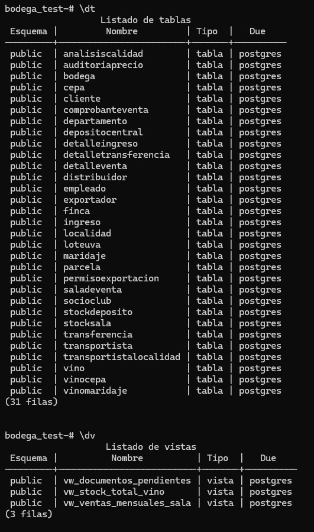
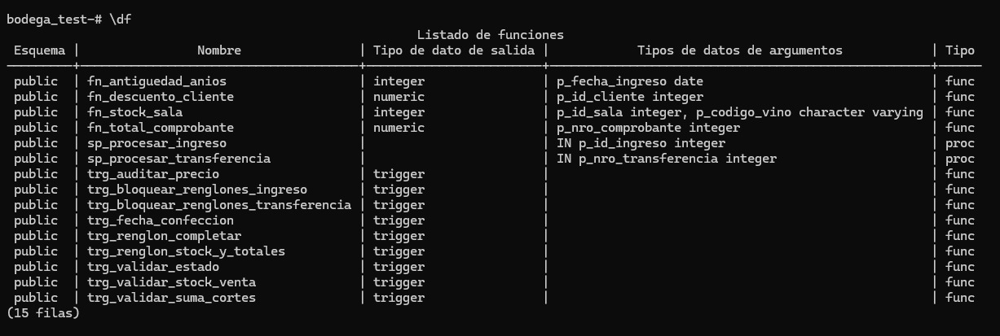
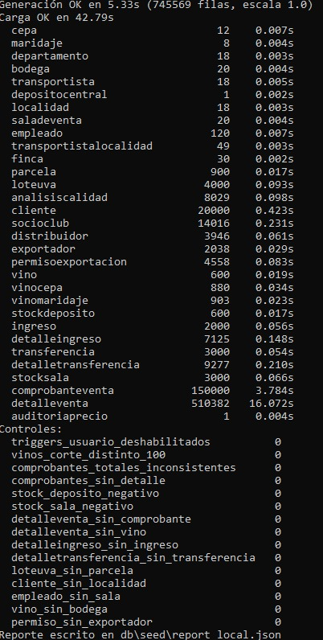
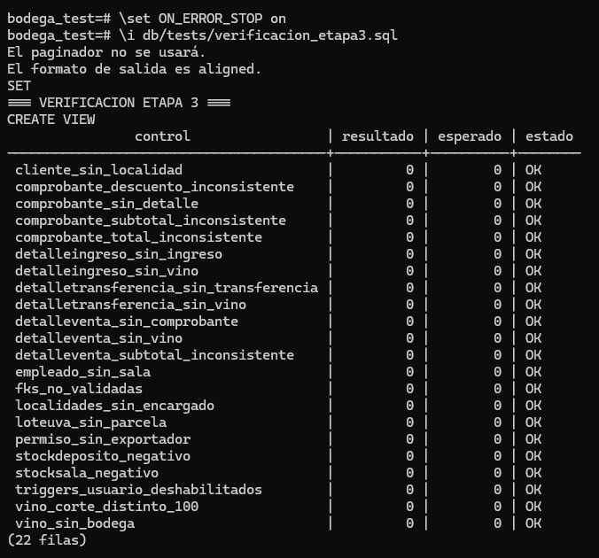
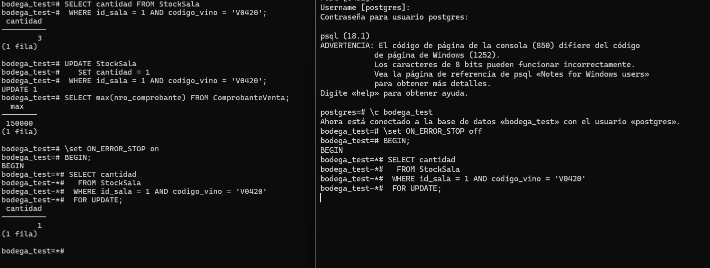
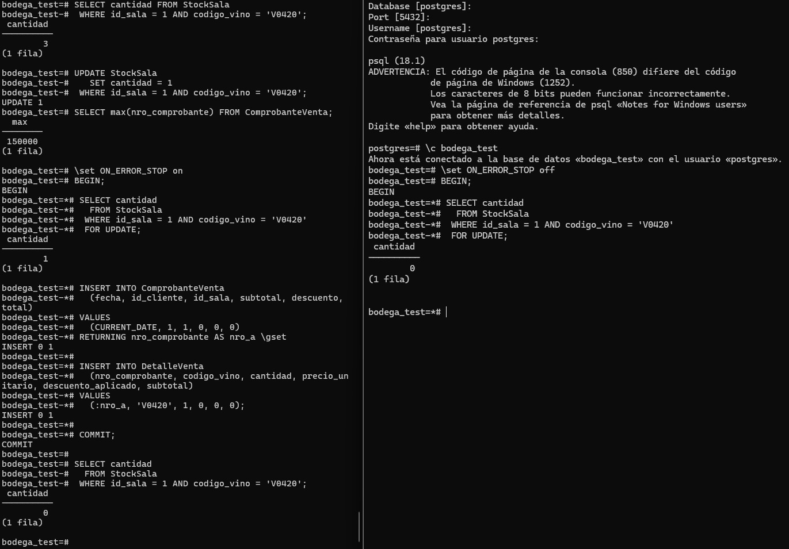
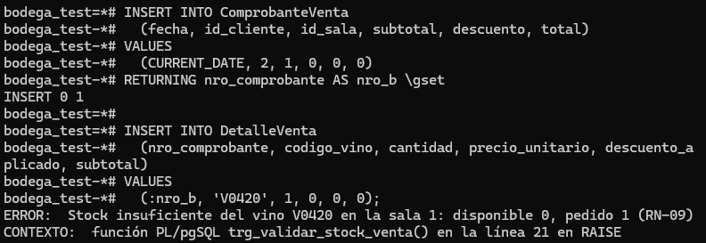
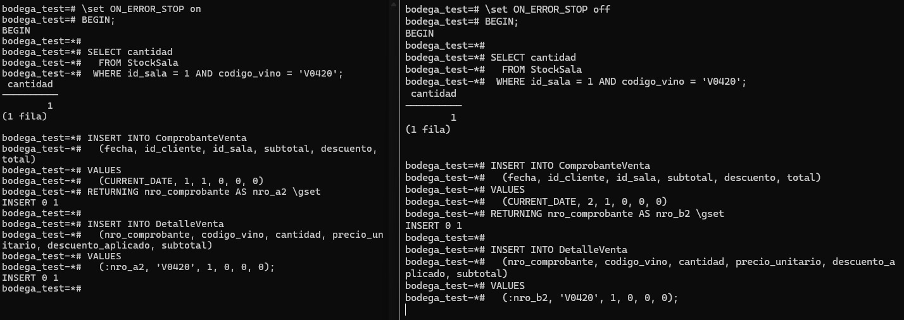
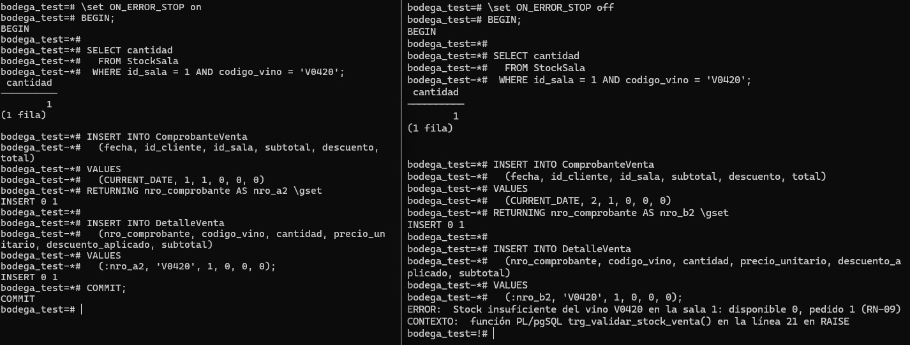

## Informe por escrito de pasos y decisiones

# Etapa 1

## Entregables

| Entregable | Archivo |
|---|---|
| DER (imagen) | `docs/Diagrama DER/DER_BODEGA_2.0.drawio.png` |
| DER (fuente editable) | `docs/Diagrama DER/DER_BODEGA_2.0.drawio` |
| Esquema relacional | `docs/Diagrama Relacional/Relacional_Bodega.EAP` |
| Esquema relacional (1FN) | `docs/Diagrama Relacional/Relacional_BD_1NF.EAP` |
| Imagen del modelo lógico | `docs/Diagrama Relacional/Logical Model.bmp` |
| Diccionario de datos | `docs/Diccionario/Diccionario_Datos_Bodegas_del_Atuel-v3.pdf` |
| DDL del esquema | `db/migrations/001_esquema.sql` |
| Restricciones de integridad | `db/migrations/002_constraints.sql` |

## DER

El DER usa una notación consistente para entidades, atributos, claves, cardinalidades mínima y máxima, entidades débiles y relaciones N:M con atributos. Las decisiones principales son:

- **Entidad débil `Parcela`:** depende de `Finca`; su clave es compuesta `(nro_parcela, id_finca)` y no existe sin la finca.
- **Jerarquía de `Cliente`:** supertipo `Cliente` con los subtipos `SocioClub`, `Distribuidor` y `Exportador`. El supertipo concentra los datos comunes y cada subtipo agrega sus atributos propios.
- **Relaciones N:M con atributos:** `VinoCepa` (porcentaje de corte), `VinoMaridaje`, `TransportistaLocalidad` y los renglones de comprobante, ingreso y transferencia.
- **Cardinalidades:** una bodega elabora muchos vinos; un vino pertenece a una bodega; una finca tiene muchas parcelas; una parcela produce muchos lotes de uva; un comprobante tiene muchos renglones y cada renglón referencia un vino; una sala tiene stock de muchos vinos y un vino puede estar en muchas salas.
- **Catálogos:** `Cepa`, `Maridaje`, `Departamento`, `Localidad` y `Transportista` se modelan como entidades independientes para evitar duplicar descripciones.

La imagen del DER y su archivo fuente están enlazados en la tabla de entregables; el DER completo se entrega junto con este informe.


## Esquema relacional

La transformación del DER al modelo relacional sigue estas reglas:

- Una relación por entidad y una relación por cada N:M. Las claves primarias se declaran en `001_esquema.sql` y las restricciones adicionales en `002_constraints.sql`.
- `Parcela` conserva la clave compuesta `(nro_parcela, id_finca)` y una FK `id_finca → Finca(id_finca)`.
- La jerarquía de clientes se mapea con **supertipo más subtipos**: `Cliente(id_cliente)` es el supertipo y `SocioClub`, `Distribuidor` y `Exportador` tienen `id_cliente` como PK y FK hacia `Cliente`. Así los atributos propios de cada subtipo no quedan como columnas nulas en una tabla única.
- Los renglones (`DetalleVenta`, `DetalleIngreso`, `DetalleTransferencia`) son relaciones débiles de su cabecera y usan claves compuestas. `VinoCepa` usa `(codigo_vino, id_cepa)`; `StockSala` usa `(id_sala, codigo_vino)`.
- `TransportistaLocalidad` y `VinoMaridaje` no tienen atributos propios y usan claves compuestas.
- `AuditoriaPrecio` es una relación independiente con PK subrogada `id_auditoria` y FK hacia `Vino`.

### Claves naturales y subrogadas

| Relación | Clave | Tipo | Justificación |
|---|---|---|---|
| `Bodega` | `cuit` | Natural | Es el identificador real de la bodega, estable y usado por las FK de ingresos, lotes y vinos. |
| `Empleado` | `cuit` | Natural | Identificador real y estable; se usa como encargado de localidad. |
| `Vino` | `codigo_vino` | Natural | Código de negocio que aparece en renglones, stock y auditoría. |
| `Cliente` | `id_cliente` | Subrogada | El CUIT no se declara único y el cliente puede cambiar de datos; el identificador interno evita propagar cambios. |
| `Localidad` | `id_localidad` | Subrogada | Se agrega `UNIQUE (nombre, provincia)` como clave candidata natural; el ID simplifica las FK. |
| `ComprobanteVenta` | `nro_comprobante` | Subrogada | La numeración la administra el sistema y no depende de datos del negocio. |
| `Parcela` | `(nro_parcela, id_finca)` | Natural compuesta | Es una entidad débil: el número de parcela solo es único dentro de su finca. |

## Normalización hasta 3FN

Las dependencias funcionales relevantes son:

- `Cliente`: `id_cliente → apellido, nombre, cuit, tipo_cliente, tipo_documento, nro_documento, calle_cliente, nro_calle_cliente, id_localidad, fecha_alta, descuento_porcentaje`. La PK es simple, por lo que no hay dependencias parciales. `tipo_cliente → descuento_porcentaje` no es una dependencia funcional global porque el escenario permite descuentos especiales por cliente (por ejemplo, exportadores con más de tres permisos al 35 %); por eso el descuento efectivo se guarda en la columna y no se deriva del tipo.
- `Localidad`: `id_localidad → nombre, provincia, codigo_postal, cuit_encargado`; `(nombre, provincia)` es clave candidata. No hay dependencias transitivas dentro de la relación.
- `Vino`: `codigo_vino → nombre_comercial, tipo, anada, presentacion_ml, graduacion_alcoholica, precio_venta, cuit_bodega`; `(nombre_comercial, anada, presentacion_ml)` es clave candidata.
- `ComprobanteVenta`: `nro_comprobante → fecha, id_cliente, id_sala, subtotal, descuento, total`.
- `DetalleVenta`: `(nro_comprobante, codigo_vino) → cantidad, precio_unitario, descuento_aplicado, subtotal`. `precio_unitario` y `descuento_aplicado` son valores históricos del renglón, no del vino actual; dependen de la clave completa. `subtotal` depende de la clave completa y se mantiene por trigger.
- `DetalleIngreso`: `(id_ingreso, codigo_vino) → cantidad_botellas`.
- `DetalleTransferencia`: `(nro_transferencia, codigo_vino) → cantidad`.
- `VinoCepa`: `(codigo_vino, id_cepa) → porcentaje_corte`; la clave es completa.
- `StockSala`: `(id_sala, codigo_vino) → cantidad`.
- `StockDeposito`: `(id_deposito, codigo_vino) → cantidad`.
- `PermisoExportacion`: `id_permiso → id_cliente, codigo_permiso, fecha_emision, fecha_vencimiento`.
- `Empleado`: `cuit → nombre, apellido, salario, id_sala`.
- `Parcela`: `(nro_parcela, id_finca) → superficie, anio_plantacion, id_cepa`; no hay dependencias parciales porque `superficie`, `anio_plantacion` e `id_cepa` dependen de la parcela completa.
- `TransportistaLocalidad` y `VinoMaridaje`: solo contienen la clave compuesta, sin atributos no clave.

En todas las relaciones los atributos no clave dependen de la clave completa y no existen dependencias transitivas dentro de la misma relación. Las referencias entre relaciones se resuelven con FK, no duplicando datos. Por eso el esquema está en 3FN.

Los importes usan `NUMERIC(p,s)` y nunca `FLOAT`; las fechas usan `DATE` o `TIMESTAMP`; los estados usan el ENUM `estado_documento` o columnas con CHECK, no texto libre.

## Decisiones de diseño de la sección 5

### Jerarquía de clientes

Se eligió **supertipo más subtipos**. Ventajas: los atributos comunes viven en `Cliente`, cada subtipo tiene solo sus columnas obligatorias y se pueden agregar subtipos sin llenar de nulos la tabla principal. Desventajas: consultar un cliente completo requiere unir el supertipo con su subtipo y la exclusividad de subtipos debe cuidarse en la carga o en la API. Se descartó la tabla única porque obligaría a columnas nulas y CHECK condicionales, y se descartó una tabla por subtipo porque duplicaría los datos comunes y complicaría las FK de comprobantes.

### Tipos de datos

- Dinero y cantidades: `NUMERIC`, nunca `FLOAT`.
- Fechas: `DATE`; fecha y hora de auditoría: `TIMESTAMP`.
- Estados de documentos: ENUM `estado_documento` con `en_confeccion`, `terminado` y `procesado`.
- CUIT: DOMAIN `cuit_dom` de 11 caracteres.
- Tipos de cliente, vino, cepa y día de cierre: `varchar` con CHECK de valores permitidos.

### Atributos derivados

- `DetalleVenta.subtotal`, `ComprobanteVenta.subtotal`, `ComprobanteVenta.descuento` y `ComprobanteVenta.total` se almacenan como resultados históricos y los mantienen los triggers de la Etapa 2. La función `fn_total_comprobante` permite recalcular el total desde los renglones.
- `DetalleVenta.precio_unitario` y `DetalleVenta.descuento_aplicado` son copias históricas del precio y del descuento al momento de la venta; no se recalculan con los valores actuales del vino o del cliente.
- El stock se almacena en `StockDeposito` y `StockSala` y lo modifican los procedimientos y triggers; los CHECK impiden valores negativos.
- La consistencia de los derivados se garantiza con triggers, CHECK, funciones de recálculo y los controles de `db/tests/verificacion_etapa3.sql`.

### Acciones referenciales

- `ON DELETE RESTRICT` en los maestros con movimientos que no deben borrarse: `Vino`, `Bodega` y `Transportista`. También se usa en las referencias con historia de `Localidad` y `SalaDeVenta`. Así no se borra un maestro que todavía tiene operaciones asociadas.
- `ON DELETE CASCADE` en filas que no existen sin su cabecera: renglones de comprobante, ingreso y transferencia; subtipos de cliente; permisos de exportación; parcelas de una finca.
- `ON DELETE RESTRICT` en `Localidad.cuit_encargado`, para impedir borrar al encargado de una localidad; primero debe reasignarse el encargado.
- `ON UPDATE CASCADE` en claves naturales (`cuit`, `codigo_vino`, `id_localidad` cuando corresponde) para propagar un cambio de identificador; `ON UPDATE NO ACTION` en claves subrogadas, que no deberían cambiar.
- `ON DELETE NO ACTION` en catálogos y referencias sin historia propia (`Departamento`, `Cepa`, `Maridaje`, `DepositoCentral`) y en cabeceras que no deben desaparecer si tienen documentos asociados, para impedir borrados accidentales.

# Etapa 2

## Funciones implementadas (`003_funciones.sql`)

Se implementaron cuatro funciones de solo lectura. Todas son `STABLE` porque consultan tablas o dependen de `CURRENT_DATE`; ninguna es `IMMUTABLE`.

| Función | Regla | Propósito | Parámetros | Retorno | Volatilidad |
|---|---|---|---|---|---|
| `fn_total_comprobante` | RN-08 | Total del comprobante a partir de sus renglones con descuento | `p_nro_comprobante integer` | `numeric(12,2)` | `STABLE` |
| `fn_stock_sala` | RN-09 | Stock de un vino en una sala; 0 si no existe | `p_id_sala integer`, `p_codigo_vino varchar(50)` | `integer` | `STABLE` |
| `fn_descuento_cliente` | RN-06 | Descuento registrado en `Cliente.descuento_porcentaje` (por defecto 10 %, 20 % o 30 % según el tipo) | `p_id_cliente integer` | `numeric(5,2)` | `STABLE` |
| `fn_antiguedad_anios` | U2 / D3 | Años cumplidos desde una fecha de ingreso | `p_fecha_ingreso date` | `integer` | `STABLE` |

### Decisiones de diseño

- `fn_total_comprobante` suma `DetalleVenta.subtotal` para no duplicar la fórmula del descuento por renglón. El trigger de la etapa 2 será el encargado de mantener actualizado ese subtotal y el total de la cabecera.
- `fn_stock_sala` devuelve `0` cuando no existe fila en `StockSala`, de modo que la validación de RN-09 rechace la venta por stock insuficiente.
- `fn_descuento_cliente` es la fuente de verdad del RN-06: devuelve el valor almacenado en `Cliente.descuento_porcentaje`, que el CHECK de rango mantiene entre 0 y 100. El trigger de venta usa esa función, de modo que un descuento especial cargado en la columna se aplica sin cambiar el código de la base.
- `fn_antiguedad_anios` usa `CURRENT_DATE`, por eso es `STABLE` y no `IMMUTABLE`. No se utiliza dentro de un CHECK, tal como advierte el PDF.
- Los casos de prueba de estas funciones están en `db/tests/db_tests.sql`.

## Procedimientos transaccionales (`004_procedimientos.sql`)

| Procedimiento | Regla | Propósito | Parámetros | Efecto |
|---|---|---|---|---|
| `sp_procesar_ingreso` | RN-10 | Procesa un ingreso terminado y lo pasa a procesado | `p_id_ingreso integer` | Suma botellas a `StockDeposito` |
| `sp_procesar_transferencia` | RN-11 | Procesa una transferencia terminada | `p_nro_transferencia integer` | Descuenta del depósito y suma a `StockSala` |

### Decisiones de diseño

- Se bloquean las filas del documento, sus renglones y las filas de stock con `FOR UPDATE`.
- El orden de bloqueo es documento → renglones → stock del depósito → stock de la sala, ordenando por `codigo_vino` para evitar deadlocks.
- Los ingresos crean la fila de `StockDeposito` si no existe.
- Las transferencias rechazan el procesamiento si falta la fila de stock del depósito o si la cantidad es insuficiente, cubriendo el caso advertido en el Anexo A.6.
- Los procedimientos no hacen `COMMIT` ni `ROLLBACK`: la atomicidad queda garantizada por la transacción del llamador.
- Solo se permite la transición `terminado → procesado`; no se reprocesa un documento.
- Los triggers de estados, bloqueo de renglones y fecha de confección se implementan en `005_triggers.sql`.
- Los casos de prueba de los procedimientos están en `db/tests/db_tests.sql`.

## Triggers implementados (`005_triggers.sql`)

| Trigger | Evento | Regla | Qué garantiza |
|---|---|---|---|
| `trg_renglon_1_completar` | `BEFORE INSERT` en `DetalleVenta` | RN-06, RN-08 | Completa precio unitario, descuento del cliente y subtotal del renglón; no se cargan a mano |
| `trg_renglon_2_valida_stock` | `BEFORE INSERT` en `DetalleVenta` | RN-09 | Rechaza la venta si la sala no tiene stock; bloquea la fila con `FOR UPDATE` |
| `trg_renglon_3_stock_y_totales` | `AFTER INSERT` en `DetalleVenta` | RN-08, RN-09 | Descuenta stock de la sala y recalcula subtotal, descuento y total del comprobante |
| `trg_ingreso_estado` / `trg_transferencia_estado` | `BEFORE UPDATE OF estado` | RN-10, RN-11 | Solo permite `en_confeccion → terminado → procesado`, sin retrocesos |
| `trg_transferencia_fecha` | `BEFORE INSERT OR UPDATE OF fecha_confeccion` | RN-11 | Fuerza la fecha actual al insertar y prohíbe modificarla |
| `trg_detalle_ingreso_bloqueo` / `trg_detalle_transferencia_bloqueo` | `BEFORE INSERT/UPDATE/DELETE` en renglones | RN-12 | No admite cambios en renglones si el documento no está en `en_confeccion` |
| `trg_vino_auditoria_precio` | `AFTER UPDATE OF precio_venta` en `Vino` | RN-13 | Audita precio anterior, precio nuevo, fecha y usuario |
| `trg_vinocepa_suma_100` / `trg_vino_suma_100` | `CONSTRAINT TRIGGER` diferido | RN-05 | Al cerrar la transacción, los porcentajes de corte de cada vino suman 100 |

### Decisiones de diseño

- El orden de los triggers de `DetalleVenta` está fijado por el prefijo numérico del nombre: primero se completa el renglón, después se valida el stock y por último se descuenta y se recalculan los totales.
- `trg_renglon_1_completar` bloquea la cabecera del comprobante con `FOR UPDATE`. Así, dos altas simultáneas de renglones del mismo comprobante se serializan y la segunda recalcula los totales viendo el renglón de la primera.
- `trg_renglon_2_valida_stock` usa `FOR UPDATE` sobre `StockSala`. Si dos sesiones intentan vender la última botella, la segunda espera a que la primera termine y luego falla por stock insuficiente; el stock nunca queda negativo.
- Los triggers de estado usan el tipo ENUM y solo habilitan las transiciones hacia adelante. Los procedimientos de `004_procedimientos.sql` son los que mueven el stock y cambian el estado.
- Los triggers de bloqueo de renglones usan `FOR SHARE` sobre la cabecera para que el documento no cambie de estado mientras se carga un renglón. Si la cabecera ya no existe por un borrado en cascada, el trigger permite borrar los renglones.
- RN-05 se implementa con `CONSTRAINT TRIGGER DEFERRABLE INITIALLY DEFERRED` para permitir cargar las cepas de a una dentro de la misma transacción; la validación ocurre al hacer `COMMIT`. Por eso un vino debe insertarse junto con su composición.
- La auditoría de precios usa `CURRENT_USER` y el `DEFAULT CURRENT_TIMESTAMP` de `AuditoriaPrecio.fecha_hora`; el trigger solo inserta precio anterior, precio nuevo y usuario.
- Para la carga masiva de la etapa 3 se pueden deshabilitar temporalmente los triggers de usuario y volver a habilitarlos, validando la composición de los vinos con consultas de control.
- Los casos de prueba de los triggers están en `db/tests/db_tests.sql`.

## Vistas implementadas (`006_vistas.sql`)

| Vista | Propósito | Reglas |
|---|---|---|
| `vw_stock_total_vino` | Stock total por vino, sumando depósito y salas | RN-09 |
| `vw_ventas_mensuales_sala` | Ventas mensuales agregadas por sala | RN-08 |
| `vw_documentos_pendientes` | Ingresos y transferencias que aún no están procesados | RN-10, RN-11 |

Las vistas son de solo lectura y se apoyan en las tablas y funciones ya implementadas; no recalculan reglas por fuera de la base.

## Roles y privilegios (`007_roles.sql`)

| Rol | Uso | Privilegios |
|---|---|---|
| `bodega_propietario` | Administración de la base | Uso y creación en `public`; todos los privilegios sobre tablas, secuencias, funciones y procedimientos |
| `bodega_api` | Lectura/escritura de la API | `SELECT`, `INSERT`, `UPDATE` y `DELETE` sobre tablas; secuencias; ejecución de funciones y procedimientos |
| `bodega_lectura` | Reportes | `SELECT` sobre tablas y ejecución de las cuatro funciones |

Se revocan los privilegios de `PUBLIC` sobre la base, el esquema, las tablas, las secuencias, las funciones y los procedimientos. Las contraseñas no se guardan en el repositorio: se asignan en el despliegue con `ALTER ROLE ... PASSWORD` a partir de variables de entorno.

La tabla `AuditoriaPrecio` es **append-only** para `bodega_api`: el trigger de auditoría inserta las filas y la API solo puede consultarlas. Por eso, después del `GRANT` general, se ejecuta:

```sql
REVOKE UPDATE, DELETE ON AuditoriaPrecio FROM bodega_api;
```

El `INSERT` se conserva porque el trigger se ejecuta con los privilegios del usuario que actualiza `Vino`.

## Trazabilidad RN-01 a RN-15

| Regla | Mecanismo en la base | Caso de prueba |
|---|---|---|
| RN-01 | `UNIQUE (nombre_comercial, anada, presentacion_ml)` + `CHECK (precio_venta > 0)` | `db_tests.sql`, sección RN-01 |
| RN-02 | `Localidad.cuit_encargado NOT NULL` + FK diferible a `Empleado` + FK `SalaDeVenta.id_localidad` | `db_tests.sql`, sección RN-02 |
| RN-03 | FK `Empleado.id_sala` | `db_tests.sql`, sección RN-03 |
| RN-04 | `Parcela.id_cepa` + `UNIQUE (id_finca, nro_parcela, campania)` en `LoteUva` | `db_tests.sql`, sección RN-04 |
| RN-05 | `trg_vinocepa_suma_100` y `trg_vino_suma_100` (constraint trigger diferido) | `db_tests.sql`, sección RN-05 |
| RN-06 | `fn_descuento_cliente` + `CHECK (descuento_porcentaje BETWEEN 0 AND 100)` + `trg_renglon_1_completar` | `db_tests.sql`, sección RN-06 (incluye descuento especial de 12.50) |
| RN-07 | FK `PermisoExportacion.id_cliente` + `CHECK (fecha_vencimiento > fecha_emision)` | `db_tests.sql`, sección RN-07 |
| RN-08 | `fn_total_comprobante` + `trg_renglon_1_completar` + `trg_renglon_3_stock_y_totales` | `db_tests.sql`, sección RN-08 |
| RN-09 | `trg_renglon_2_valida_stock` + `trg_renglon_3_stock_y_totales` + CHECK de stock no negativo | `db_tests.sql`, sección RN-09 |
| RN-10 | `sp_procesar_ingreso` + `trg_ingreso_estado` | `db_tests.sql`, sección RN-10 |
| RN-11 | `sp_procesar_transferencia` + `trg_transferencia_estado` + `trg_transferencia_fecha` | `db_tests.sql`, sección RN-11 |
| RN-12 | `trg_detalle_ingreso_bloqueo` y `trg_detalle_transferencia_bloqueo` | `db_tests.sql`, sección RN-12 |
| RN-13 | `trg_vino_auditoria_precio` + tabla `AuditoriaPrecio` | `db_tests.sql`, sección RN-13 |
| RN-14 | FK con `ON DELETE RESTRICT` en `Vino`, `Bodega` y `Transportista` | `db_tests.sql`, sección RN-14 |
| RN-15 | CHECK de cantidades, precios, superficies, kilos y stock positivos o no negativos | `db_tests.sql`, sección RN-15 |

Cada caso de `db_tests.sql` incluye comentarios con el error esperado y el SQLSTATE cuando corresponde. Los casos que deben fallar se ejecutan dentro de `SAVEPOINT` y se revierten para no dejar datos inconsistentes.

## Dónde va cada regla

| Tipo de regla | Herramienta | Ejemplo en este esquema |
|---|---|---|
| Valor válido de una sola fila, calculable siempre | `NOT NULL`, `CHECK`, `DOMAIN` | `precio_venta > 0`, `cuit_dom` |
| Unicidad de una combinación | `UNIQUE` o PK | `(nombre_comercial, anada, presentacion_ml)` |
| Referencia entre relaciones | FK | `SalaDeVenta.id_localidad → Localidad` |
| Invariante entre varias filas o agregado | Función + trigger | suma de cortes 100, stock disponible |
| Transición de estados | Trigger `BEFORE UPDATE` | `en_confeccion → terminado → procesado` |
| Operación de varios pasos que debe ser atómica | Procedimiento transaccional | procesar una transferencia |
| Dato derivado que debe mantenerse consistente | Trigger y función de recálculo | subtotales y totales de comprobantes |
| Historia de cambios | Trigger `AFTER` | auditoría de precios |
| Seguridad y separación de responsabilidades | Roles, `GRANT` y `REVOKE` | `bodega_api`, `bodega_lectura` |

La regla general es usar la restricción más simple que exprese la regla. Si alcanza con un CHECK o una FK, no se usa un trigger; los triggers quedan para invariantes que involucran varias filas, estados o historia.

## Demostración de concurrencia

La prueba se ejecutó sobre la base local `bodega_test` en PostgreSQL 18, con las migraciones `001` a `007` aplicadas y los datos cargados con `db/seed/load.py`. Se usaron dos sesiones `psql` conectadas a la misma base y el nivel de aislamiento por defecto de PostgreSQL, `READ COMMITTED`.

### Configuración previa de `bodega_test`

Antes de la demo se verificó que la base tuviera el esquema, las vistas y las funciones creadas. La carga se ejecutó con:

```powershell
.\.venv\Scripts\python.exe db/seed/load.py --reset --scale 1.0 --base-date 2026-11-08
```

Las capturas muestran la salida de `\dt`, `\dv`, `\df` y de las consultas de control.



*Salida de `\dt` y `\dv`: tablas y vistas creadas en `bodega_test`.*



*Salida de `\df`: funciones y procedimientos disponibles.*



*Resultado de la carga de datos en las tablas.*



*Controles de `verificacion_etapa3.sql`.*

[Salida de consultas de verificación](capturas/ejecuci_n_consultas_bodega.pdf)

*Conteos y consultas ejecutadas sobre `bodega_test`.*

### Escenario

Se utilizó la sala 1, el vino `V0420` (Romero Espumante 0420) y los clientes 1 y 2. El stock original de la sala para ese vino era 3; para la prueba se dejó en 1. Al finalizar se eliminaron los comprobantes generados y se restauró el stock a 3.

### Preparación

```sql
UPDATE StockSala
   SET cantidad = 1
 WHERE id_sala = 1
   AND codigo_vino = 'V0420';
```

### Con `SELECT ... FOR UPDATE`

#### Sesión A

```sql
BEGIN;
SELECT cantidad
  FROM StockSala
 WHERE id_sala = 1
   AND codigo_vino = 'V0420'
   FOR UPDATE;              -- devuelve 1 y bloquea la fila

INSERT INTO ComprobanteVenta (fecha, id_cliente, id_sala, subtotal, descuento, total)
VALUES (CURRENT_DATE, 1, 1, 0, 0, 0)
RETURNING nro_comprobante AS nro_a \gset

INSERT INTO DetalleVenta (nro_comprobante, codigo_vino, cantidad, precio_unitario, descuento_aplicado, subtotal)
VALUES (:nro_a, 'V0420', 1, 0, 0, 0);

COMMIT;                     -- el trigger descuenta la botella
```

#### Sesión B

```sql
BEGIN;
SELECT cantidad
  FROM StockSala
 WHERE id_sala = 1
   AND codigo_vino = 'V0420'
   FOR UPDATE;              -- espera a que A termine

-- Cuando A hace COMMIT, esta consulta devuelve 0.
INSERT INTO ComprobanteVenta (fecha, id_cliente, id_sala, subtotal, descuento, total)
VALUES (CURRENT_DATE, 2, 1, 0, 0, 0)
RETURNING nro_comprobante AS nro_b \gset

INSERT INTO DetalleVenta (nro_comprobante, codigo_vino, cantidad, precio_unitario, descuento_aplicado, subtotal)
VALUES (:nro_b, 'V0420', 1, 0, 0, 0);

-- ERROR ESPERADO: stock insuficiente (RN-09).
ROLLBACK;
```

Con `FOR UPDATE`, la segunda sesión no puede leer la fila mientras la primera la tiene bloqueada. Al continuar, ve el stock ya descontado y el trigger `trg_renglon_2_valida_stock` rechaza la venta. El stock nunca queda negativo.

### Sin `SELECT ... FOR UPDATE`

Se restauró el stock a 1 y se repitió el experimento sin el bloqueo explícito.

#### Sesión A

```sql
BEGIN;
SELECT cantidad
  FROM StockSala
 WHERE id_sala = 1
   AND codigo_vino = 'V0420';   -- devuelve 1, sin bloquear

INSERT INTO ComprobanteVenta (fecha, id_cliente, id_sala, subtotal, descuento, total)
VALUES (CURRENT_DATE, 1, 1, 0, 0, 0)
RETURNING nro_comprobante AS nro_a2 \gset

INSERT INTO DetalleVenta (nro_comprobante, codigo_vino, cantidad, precio_unitario, descuento_aplicado, subtotal)
VALUES (:nro_a2, 'V0420', 1, 0, 0, 0);

-- La transacción queda abierta: el stock ya se descontó, pero A todavía no confirmó.
```

#### Sesión B

```sql
BEGIN;
SELECT cantidad
  FROM StockSala
 WHERE id_sala = 1
   AND codigo_vino = 'V0420';   -- devuelve 1: lectura vieja, sin bloqueo

INSERT INTO ComprobanteVenta (fecha, id_cliente, id_sala, subtotal, descuento, total)
VALUES (CURRENT_DATE, 2, 1, 0, 0, 0)
RETURNING nro_comprobante AS nro_b2 \gset

INSERT INTO DetalleVenta (nro_comprobante, codigo_vino, cantidad, precio_unitario, descuento_aplicado, subtotal)
VALUES (:nro_b2, 'V0420', 1, 0, 0, 0);
-- Queda esperando el lock del trigger.
```

Cuando A ejecuta `COMMIT`, B se desbloquea y el trigger vuelve a leer el stock:

```text
ERROR: Stock insuficiente del vino V0420 en la sala 1: disponible 0, pedido 1 (RN-09)
```

B ejecuta `ROLLBACK`.

> Para reproducir la sesión B en `psql` sin que el error esperado corte el script, ejecutarla con `\set ON_ERROR_STOP off`.

### Explicación

Bajo `READ COMMITTED` cada sentencia ve la última versión confirmada, pero un `SELECT` normal no bloquea la fila. Sin `FOR UPDATE`, ambas sesiones pueden leer `cantidad = 1` antes de que alguna escriba; la lectura de B queda vieja. `FOR UPDATE` bloquea la fila y, al liberarse, devuelve la versión actualizada. El trigger de validación de stock también usa `FOR UPDATE`, por eso serializa la escritura y protege la invariante aunque la aplicación no bloquee la lectura. El `CHECK (cantidad >= 0)` es la última barrera contra stock negativo.

### Capturas de la prueba



*A mantiene el lock y B espera en el `SELECT ... FOR UPDATE`.*



*B recibe `cantidad = 0` y el trigger rechaza la venta con RN-09.*



*A y B leen `cantidad = 1`.*



*A ya descontó el stock, pero la transacción sigue abierta; B espera el lock del trigger.*



*B se desbloquea y el trigger rechaza la venta con RN-09.*

# Etapa 3

## Catálogos reales (Anexo B)

El paso 1 de la etapa pide cargar los catálogos reales desde archivos CSV, sin generarlos al azar. Los archivos se guardan en `db/seed/` con codificación UTF-8, encabezado, coma como separador e identificadores explícitos y determinísticos, de modo que dos ejecuciones del futuro script de carga produzcan los mismos datos.

| Archivo | Tabla destino | Filas | Columnas | Fuente |
|---|---|---|---|---|
| `cepas.csv` | `Cepa` | 12 | `id_cepa`, `nombre`, `tipo` | Anexo B.1 |
| `maridajes.csv` | `Maridaje` | 8 | `id_maridaje`, `nombre`, `temperatura_servicio` | Anexo B.2 |
| `tipos_vino.csv` | — (catálogo de referencia) | 4 | `tipo` | Anexo B.4 |
| `departamentos.csv` | `Departamento` | 18 | `id_departamento`, `nombre`, `provincia` | Anexo B.3 |
| `localidades.csv` | `Localidad` | 18 | `id_localidad`, `nombre`, `provincia`, `codigo_postal` | Anexo B.3 (capitales) |

### Contenido de los catálogos

- **Cepas (12):** 7 tintas (Malbec, Cabernet Sauvignon, Merlot, Syrah, Bonarda, Tempranillo y Pinot Noir) y 5 blancas (Chardonnay, Sauvignon Blanc, Torrontés, Chenin Blanc y Semillón).
- **Maridajes (8):** Carnes rojas (17 °C), Quesos duros (16 °C), Pastas con salsa roja (16 °C), Carnes blancas (12 °C), Quesos blandos (10 °C), Pescados y mariscos (8 °C), Entradas y fiambres (10 °C) y Postres (8 °C).
- **Tipos de vino (4):** Tinto, Blanco, Rosado y Espumante, con la misma grafía que exige el `CHECK` de `Vino.tipo`.
- **Departamentos y localidades (18):** se tomó una localidad cabecera por cada departamento del Anexo B.3.

| ID | Departamento | Localidad cabecera | Código postal |
|---|---|---|---|
| 1 | San Rafael | San Rafael | 5600 |
| 2 | General Alvear | General Alvear | 5620 |
| 3 | Malargüe | Malargüe | 5613 |
| 4 | Luján de Cuyo | Luján de Cuyo | 5507 |
| 5 | Maipú | Maipú | 5515 |
| 6 | Tupungato | Tupungato | 5561 |
| 7 | Tunuyán | Tunuyán | 5560 |
| 8 | San Carlos | Villa San Carlos | 5569 |
| 9 | Lavalle | Villa Tulumaya | 5533 |
| 10 | Rivadavia | Rivadavia | 5577 |
| 11 | Junín | Junín | 5573 |
| 12 | San Martín | San Martín | 5570 |
| 13 | Santa Rosa | Santa Rosa | 5596 |
| 14 | La Paz | La Paz | 5590 |
| 15 | Godoy Cruz | Godoy Cruz | 5501 |
| 16 | Guaymallén | Villa Nueva | 5521 |
| 17 | Las Heras | Las Heras | 5539 |
| 18 | Capital | Mendoza | 5500 |

### Decisiones de diseño

- Se usan IDs enteros explícitos en los CSV en lugar de dejar que la base los genere: así las claves foráneas de las etapas posteriores son predecibles y la carga es reproducible con semilla fija.
- `tipos_vino.csv` es un catálogo de referencia y no tiene tabla destino. El esquema no define una tabla `TipoVino`; la fuente de verdad es el `CHECK` de `Vino.tipo`, y el futuro generador de vinos toma de este CSV los cuatro valores válidos.
- `Localidad` no tiene clave foránea hacia `Departamento` en el esquema de la etapa 1. Los departamentos se usan para las fincas y como referencia para definir las capitales departamentales; por eso `localidades.csv` no incluye una columna `departamento` y la correspondencia queda documentada en la tabla anterior.
- `cuit_encargado` se asigna a un empleado generado antes de cargar las tablas. La FK diferible `Localidad → Empleado` permite insertar primero la localidad y luego completar el ciclo `Localidad → Empleado → SalaDeVenta → Localidad` dentro de la misma transacción.
- Los acentos se conservan en UTF-8 (Malargüe, Luján de Cuyo, Guaymallén, Torrontés, Semillón, Junín, Maipú). Los valores de `tipo` de cepa y de vino respetan las mayúsculas y la ortografía de los `CHECK` del esquema.
- Todos los datos respetan las restricciones existentes: tipo de cepa en `{Tinta, Blanca}`, temperatura de maridaje entre 5 y 25, y nombres de localidad únicos dentro de la provincia.

## Script de carga masiva (`db/seed/load.py`)

El segundo paso de la etapa pide un script reproducible que genere y cargue el volumen de datos. Se implementó en Python 3 con `psycopg` 3, `Faker` (locale `es_AR`) y `random`, con semilla fija `20261101` y fecha base `2026-11-01` (ambas configurables). Las dependencias están en `db/seed/requirements.txt` y el procedimiento completo en `db/seed/README.md`.

### Ejecución

```powershell
python -m venv .venv
.\.venv\Scripts\python.exe -m pip install -r db/seed/requirements.txt
$env:PGPASSWORD = "<password>"
.\.venv\Scripts\python.exe db/seed/load.py --dry-run --scale 0.01
.\.venv\Scripts\python.exe db/seed/load.py --reset --scale 1.0
```

Opciones: `--dsn`, `--reset`, `--scale`, `--strategy`, `--seed`, `--base-date`, `--dry-run`, `--report`, `--benchmark`, `--benchmark-scale` y `--benchmark-report`. Sin `--reset`, el script aborta si la base ya tiene datos.

Para la defensa conviene recargar con `--base-date` cercano a la fecha de la consulta, de modo que las consultas que usan `CURRENT_DATE` encuentren historial reciente. La semilla se mantiene, así que el dataset es el mismo salvo el desplazamiento de las fechas.

Para comparar estrategias sin modificar la base:

```powershell
.\.venv\Scripts\python.exe db/seed/load.py --benchmark --benchmark-scale 1.0 `
  --benchmark-report db/seed/benchmark_report.json
```

### Volúmenes cargados (escala 1.0)

| Tabla | Filas | Tabla | Filas |
|---|---:|---|---:|
| `cepa` | 12 | `maridaje` | 8 |
| `departamento` | 18 | `localidad` | 18 |
| `bodega` | 20 | `transportista` | 18 |
| `depositocentral` | 1 | `saladeventa` | 20 |
| `empleado` | 120 | `transportistalocalidad` | 49 |
| `finca` | 30 | `parcela` | 900 |
| `loteuva` | 4000 | `analisiscalidad` | 8029 |
| `cliente` | 20000 | `socioclub` | 14016 |
| `distribuidor` | 3946 | `exportador` | 2038 |
| `permisoexportacion` | 4558 | `vino` | 600 |
| `vinocepa` | 880 | `vinomaridaje` | 903 |
| `stockdeposito` | 600 | `ingreso` | 2000 |
| `detalleingreso` | 7125 | `transferencia` | 3000 |
| `detalletransferencia` | 9277 | `stocksala` | 3000 |
| `comprobanteventa` | 150000 | `detalleventa` | 510382 |
| `auditoriaprecio` | 1 | **Total** | **745569** |

`vino` se fija en 600 en lugar de 800 para que `vinocepa` y `vinomaridaje` queden dentro del rango recomendado de 300 a 1000 filas.

### Decisiones de carga

- **Reproducibilidad:** un `random.Random` independiente por sección derivado de `seed:seccion`, `Faker.seed(seed)` y ninguna dependencia de `date.today()` ni `CURRENT_TIMESTAMP`. La generación se probó dos veces con la misma semilla y produjo datasets idénticos.
- **Validación previa:** antes de conectarse, el script verifica claves primarias únicas, referencias existentes, composición de vinos, subtotales de renglones, totales de comprobantes, stock no negativo y coherencia del descuento por tipo de cliente.
- **Orden topológico:** catálogos, bodegas, transportistas y depósito; localidades; salas y empleados; fincas, parcelas, lotes y análisis; clientes y subtipos; vinos, composición, maridajes y stock; ingresos y transferencias; ventas y auditoría.
- **Dependencia circular:** `Localidad → Empleado → SalaDeVenta → Localidad` se resuelve asignando desde el inicio un empleado existente en el dataset y validando la FK diferible al confirmar la transacción.
- **Estrategia eficiente:** la carga usa `COPY` por defecto; `--strategy` permite probar `executemany` e `individual`. Las tres variantes comparten generación, orden topológico y controles.
- **Triggers:** dentro de una única transacción se deshabilitan los triggers de usuario de `DetalleVenta`, `Transferencia`, `DetalleIngreso`, `DetalleTransferencia`, `Vino` y `VinoCepa`, se carga, se habilitan de nuevo y se ejecutan controles. Un fallo revierte todo, incluidos los `DISABLE/ENABLE`.
- **Totales:** los importes de `ComprobanteVenta` se calculan en Python con la misma fórmula que los triggers de la etapa 2 (subtotal bruto, descuento en monto y total neto).
- **Secuencias:** después de insertar IDs explícitos se ejecuta `setval` para las 14 tablas con `serial`, y `ANALYZE` al final.
- **Controles:** el script falla si quedan triggers de usuario deshabilitados, si hay vinos cuya composición no suma 100, comprobantes con totales inconsistentes o sin renglones, stock negativo, renglones huérfanos o referencias faltantes en las relaciones principales.

### Eficiencia de carga

Se agregó el modo `--benchmark`, que genera un único dataset y lo inserta con `copy`, `executemany` e `individual` dentro de transacciones con `force_rollback=True`. Así se comparan tiempos sin alterar datos, secuencias ni triggers. Las tres corridas usan las mismas 745.569 filas, con triggers deshabilitados y claves foráneas activas.

| Estrategia | Inserción | Tiempo total | Filas/s | vs. individual |
|---|---:|---:|---:|---:|
| `copy` | 20,481 s | 21,975 s | 36.403,0 | 10,06x |
| `executemany` | 40,831 s | 42,412 s | 18.259,9 | 5,05x |
| `individual` | 206,065 s | 207,406 s | 3.618,1 | 1,00x |

La generación previa tardó 7,87 s y los 15 controles dieron cero en las tres estrategias. `COPY` resultó 10,06 veces más rápido que la inserción fila por fila y 2 veces más rápido que el lote con `executemany`; por eso es la estrategia por defecto. `psycopg` 3 no expone `execute_values` de `psycopg2`, así que la alternativa por lotes se implementó con `executemany`. El detalle por tabla quedó en `db/seed/benchmark_report.json`.

### Manejo de triggers en la carga histórica

| Tabla | Triggers deshabilitados | Motivo |
|---|---|---|
| `DetalleVenta` | `trg_renglon_1_completar`, `trg_renglon_2_valida_stock`, `trg_renglon_3_stock_y_totales` | Las ventas históricas no deben descontar stock actual ni recalcular totales ya calculados. |
| `Transferencia` | `trg_transferencia_estado`, `trg_transferencia_fecha` | La fecha histórica no debe reemplazarse por `CURRENT_DATE`; los documentos se cargan terminados. |
| `DetalleIngreso` | `trg_detalle_ingreso_bloqueo` | El ingreso se carga cerrado y el trigger rechazaría sus renglones. |
| `DetalleTransferencia` | `trg_detalle_transferencia_bloqueo` | La transferencia se carga cerrada y el trigger rechazaría sus renglones. |
| `Vino` | `trg_vino_auditoria_precio`, `trg_vino_suma_100` | Los precios son históricos; la composición se valida al final. |
| `VinoCepa` | `trg_vinocepa_suma_100` | La composición se controla después de cargar todas las cepas. |

`trg_ingreso_estado` no se desactiva porque es `BEFORE UPDATE OF estado` y la carga solo hace `INSERT`. Las claves foráneas siguen activas porque son triggers internos y `DISABLE TRIGGER USER` no las desactiva.

Riesgos asumidos y mitigaciones:

- **Reglas suspendidas:** el `ALTER TABLE ... DISABLE TRIGGER USER` toma un lock exclusivo y la carga corre en una única transacción, en un entorno controlado y sin sesiones concurrentes.
- **Olvido de rehabilitar:** los `DISABLE` y `ENABLE` están en la misma transacción; cualquier error revierte ambos.
- **Datos inconsistentes:** se validan invariantes en Python y se ejecutan 15 controles SQL antes del `COMMIT`.
- **Referencias:** las FK no se desactivan, por lo que se validan fila por fila durante toda la carga.

### Resultado de la prueba

Sobre `bodega_seed` con las migraciones `001` a `007`, la carga completa terminó en 20,5 segundos, con 745.569 filas y los 15 controles en cero. También se verificó que todos los triggers quedaron habilitados, que las 18 localidades tienen encargado, que las 14 secuencias quedaron por encima del máximo ID y que los 600 vinos tienen composición.

El benchmark completo se ejecutó sin alterar la base: se verificaron los conteos de `DetalleVenta`, `ComprobanteVenta`, `Vino` y `Cliente`, y que no quedaran triggers deshabilitados. La carga normal se probó además en una base temporal `bodega_smoke` con `--scale 0.01` para `copy` y `executemany`, con los 15 controles en cero.

### Verificación final y volcado

Se agregó `db/tests/verificacion_etapa3.sql`, un script independiente del cargador que ejecuta 22 controles y falla si alguno devuelve un valor distinto de cero:

```powershell
& "C:\Program Files\PostgreSQL\18\bin\psql.exe" -U postgres -d bodega_seed `
  -v ON_ERROR_STOP=1 -f db/tests/verificacion_etapa3.sql
```

| Categoría | Controles | Resultado |
|---|---:|---:|
| Stock negativo en depósito o sala | 2 | 0 |
| Coherencia de importes y composición | 6 | 0 |
| Huérfanos en relaciones principales | 11 | 0 |
| Integridad global (FK, triggers, encargados) | 3 | 0 |

Los 22 controles dieron cero. El volcado se generó con `pg_dump` 18.3 en formato SQL plano, sin propietarios ni privilegios, y se comprimió con gzip:

```text
db/dump_completo.sql.gz
10.105.169 bytes
SHA-256 08d0915c4a6f890ffc845e8c0632cc34a4a9fb340b244245a7ca9f1f709230b1
31 bloques COPY · 745.569 filas
```

Se probó la restauración en una base temporal `bodega_restore`: las 31 tablas y las 745.569 filas coincidieron con `bodega_seed`, y los 22 controles volvieron a dar cero. Luego se eliminó la base temporal. Al usar `--no-owner --no-privileges`, el volcado no depende de los roles del clúster; para recrearlos se ejecuta `db/migrations/007_roles.sql` después de restaurar.

El volcado actual se regeneró con la versión corregida de `fn_descuento_cliente`, que lee `Cliente.descuento_porcentaje` en lugar de aplicar un porcentaje fijo por tipo de cliente. Se verificó la definición de la función y los 22 controles tanto en `bodega_seed` como en `bodega_restore`.

# Etapa 4

# Etapa 5

## Alcance y método de prueba

Los archivos de `consultas/` resuelven las consignas de modificación (`U1`–`U6`, `I1`–`I6`, `D1`–`D6`) y de consulta (`S1`–`S12`). Los DML se ejecutaron con `ON_ERROR_STOP=1` dentro de bloques `BEGIN ... ROLLBACK`, por lo que cada prueba partió del mismo dataset y no dejó cambios permanentes. Las pruebas se hicieron sobre `bodega_seed`, cargada desde `db/dump_completo.sql.gz`, con fecha base `2026-11-01`.

La ejecución de evidencia se realizó el `2026-11-09` con PostgreSQL 18.3. Los comentarios de cabecera de `update.sql` para U2 y U3 quedaron desactualizados respecto del dump regenerado: la corrida real afectó 89 empleados y 29 vinos, respectivamente. No se modificaron los scripts; los valores de este informe son los observados en esa ejecución.

Evidencias versionadas:

- `consultas/salida_dml_local.txt`: salidas completas de U1–U6, I1–I6 y D1–D6.
- `consultas/salida_select_local.txt`: salidas de S1–S12.
- `consultas/explain_s9_s12.txt`: planes `EXPLAIN (ANALYZE, BUFFERS)` de S9–S12.

## Modificación de datos (U1–U6)

| Código | Operación | Filas | Resultado y controles |
|---|---|---:|---|
| U1 | Recalcular `ComprobanteVenta.total` con el descuento del cliente | 150.000 | Los totales globales no cambiaron porque el dataset ya cumplía RN-08; el control de desvíos dio 0. |
| U2 | Aumentar 20 % el salario de empleados con más de 5 años de antigüedad | 89 | Salario promedio de los 89 afectados: 1.984.474,01 → 2.381.368,81; masa salarial: 176.618.187,00 → 211.941.824,40; 0 salarios inválidos. |
| U3 | Aumentar 13 % el precio de los vinos de la bodega Ponce 01 (CUIT 34463830136) | 29 | `AuditoriaPrecio` pasó de 1 a 30 filas; 0 precios inválidos. |
| U4 | Intercambiar los días de visita Lunes y Miércoles en las salas | 4 | 4 filas modificadas; 0 días inválidos. |
| U5 | Aplicar 15 % de descuento a los 10 vinos menos vendidos | 10 | `AuditoriaPrecio` pasó de 1 a 11 filas; 0 precios inválidos. |
| U6 | Aplicar 35 % de descuento a exportadores con más de 3 permisos | 405 | Antes: 405 exportadores con 30 %; después: 405 con 35 %; 0 descuentos inválidos. |

Las actualizaciones masivas se resolvieron con expresiones de conjunto y CTE, sin cursores. U3 y U5 dispararon `trg_auditoria_precio`, que registra el precio anterior y el nuevo en `AuditoriaPrecio`; los controles posteriores verificaron que no se generaran precios nulos o no positivos.

## Inserción de datos (I1–I6)

| Código | Operación | Filas | Resultado y controles |
|---|---|---:|---|
| I1 | Agregar cobertura de un transportista en General Alvear | 1 | Se eligió el transportista 12, con 2 envíos en el último trimestre y sin cobertura previa; quedó con 2 localidades cubiertas. |
| I2 | Crear el maridaje “cordero al disco” y asociarlo a tintos de 14 % o más | 1 + 77 | 1 maridaje nuevo y 77 asociaciones en `VinoMaridaje`; 0 asociaciones inválidas. |
| I3 | Insertar un comprobante de venta con 3 renglones | 1 + 3 | Comprobante 150001: subtotal 66.873,00, descuento 6.687,30, total 60.185,70; el total coincide con `fn_total_comprobante`. El stock de los 3 vinos bajó en 1 botella. |
| I4 | Insertar una bodega nueva | 1 | Bodega CUIT 30999999991 insertada; el control de duplicados dio 0. |
| I5 | Insertar una sala nueva en San Rafael | 1 | Sala 21 creada; el máximo `id_sala` pasó de 20 a 21. |
| I6 | Insertar un ingreso con su detalle | 1 + 1 | Ingreso 2001 para V0017, transportista 1, depósito 1, 120 botellas; estado `en_confeccion`; el máximo `id_ingreso` pasó de 2000 a 2001. |

I3 e I6 ejercitan los triggers de negocio: el comprobante completa precio unitario, subtotal, descuento y total, y descuenta stock; el ingreso se registra con su detalle y conserva el estado inicial. I2 usa `ON CONFLICT DO NOTHING` sobre la clave de `VinoMaridaje` para que la asociación sea idempotente.

## Borrado de datos (D1–D6)

| Código | Operación | Filas | Resultado y controles |
|---|---|---:|---|
| D1 | Borrar comprobantes de socios con más de 5 años | 36.991 | Se eliminaron 125.818 renglones por `ON DELETE CASCADE`; comprobantes: 150.000 → 113.009; renglones: 510.382 → 384.564. |
| D2 | Borrar cepas sin vinos asociados | 0 | Quedaron 12 cepas; las 12 están en uso, por lo que no hubo filas elegibles. |
| D3 | Borrar empleados con menos de 2 años en la sala 4 (Luján de Cuyo) | 3 | Empleados de la sala: 6 → 3; 0 localidades quedaron con encargado eliminado. |
| D4 | Borrar socios sin compras y con más de 5 años | 556 | Socios: 14.016 → 13.460; 0 socios quedaron sin compras. |
| D5 | Borrar ingresos procesados con más de 1 año | 1.392 | Se eliminaron 4.937 renglones y 1.498.260 botellas por `ON DELETE CASCADE`; ingresos: 2.000 → 608; renglones: 7.125 → 2.188. |
| D6 | Borrar socios sin compras de San Rafael | 88 | Socios: 14.016 → 13.928; 0 socios de San Rafael quedaron sin compras. |

Cada bloque D es independiente y termina en `ROLLBACK`; por eso D4 y D6 parten de los 14.016 socios originales. D1, D4 y D5 dependen de acciones referenciales `ON DELETE CASCADE`; D3 usa `ON DELETE SET NULL` para el encargado de localidad, y el control confirmó que ninguna localidad quedó apuntando a un empleado borrado. D2 evita la violación de FK mediante `NOT EXISTS` sobre `VinoCepa`.

## Consultas SELECT (S1–S12)

| Código | Técnica | Resultado |
|---|---|---|
| S1 | `ROW_NUMBER()` sobre agregación | Ranking de los 10 vinos con más botellas vendidas. |
| S2 | División relacional por cardinalidad | Vinos cuya cantidad de salas distintas iguala el total de salas. |
| S3 | Filtro temporal y `COUNT(DISTINCT)` | Clientes por tipo que compraron en la sala 1 en los últimos 7 días. |
| S4 | CTE, agregación y `LIMIT` | Top 5 de salas que más solicitaron V0155 en los últimos 15 días. |
| S5 | CTE, `LEFT JOIN` y `MIN` | Salas con la menor cantidad de transferencias pendientes, incluyendo las de valor 0. |
| S6 | Anti-join con `LEFT JOIN` y `COALESCE` | Vinos sin stock en la sala 1 pero con stock en el depósito central. |
| S7 | CTE, agregación y orden con `LIMIT 1` | Transportista con mayor actividad en el último mes. |
| S8 | Join, filtro temporal y `SUM` | Monto total vendido por sala en el último trimestre. |
| S9 | CTE, `STRING_AGG` y vista de stock | Ficha completa del vino V0017 con cepas, maridajes y stock. |
| S10 | CTE y subconsulta correlacionada | Rendimiento por parcela y campaña comparado con el promedio de su finca. |
| S11a | `RANK() OVER (PARTITION BY sala)` | Ranking de vinos por botellas vendidas dentro de cada sala. |
| S11b | `SUM() OVER (... ROWS UNBOUNDED PRECEDING)` | Ventas mensuales acumuladas por sala. |
| S12a | División relacional con `NOT EXISTS` | Clientes que compraron todos los vinos de una bodega. |
| S12b | Anti-join | Clientes que nunca compraron vino tinto. |

Las consultas usan `CURRENT_DATE`, por lo que la fecha de ejecución forma parte del resultado. La salida completa, con los encabezados y las filas devueltas, está en `consultas/salida_select_local.txt`.

## Planes de ejecución (S9–S12)

Se ejecutó `EXPLAIN (ANALYZE, BUFFERS)` sobre `bodega_seed`, con 150.000 comprobantes y 510.382 renglones. Los bloques son de solo lectura y terminan en `ROLLBACK`.

| Consulta | Tiempo de ejecución | Observación |
|---|---:|---|
| S9 | 1,614 ms | Usa la vista de stock y recorridos por índice; no presenta problemas. |
| S10 | 3.344,769 ms | Es la consulta más costosa: las dos subconsultas correlacionadas (promedio usado en el `SELECT` y en el `CASE`) se ejecutan 4.000 veces cada una y recorren el CTE `rendimiento` en cada iteración. Conviene precalcular los promedios en otro CTE o usar `AVG(...) OVER (PARTITION BY id_finca, campania)`. |
| S11a | 253,965 ms | Join paralelo y `WindowAgg`; el orden final se resuelve con `Incremental Sort`. |
| S11b | 120,150 ms | Agregación mensual y ventana acumulada; sin problemas. |
| S12a | 313,336 ms | La división por `NOT EXISTS` se resuelve con anti-join sobre las compras de la bodega. |
| S12b | 248,608 ms | Anti-join contra el conjunto de clientes que compraron tintos. |

Los planes son provisionales hasta integrar la propuesta de índices de la Etapa 4. Cuando se agregue `008_indices.sql`, corresponde volver a ejecutar `consultas/explain_s9_s12.txt` para comparar tiempos y verificar que los índices elegidos sean utilizados.

# Etapa 6

## API REST

La API se implementó con FastAPI, `psycopg` 3 y `psycopg_pool`. La cadena de conexión, el tamaño del pool y los orígenes CORS se leen de variables de entorno (`DATABASE_URL`, `POOL_MIN_SIZE`, `POOL_MAX_SIZE`, `CORS_ORIGINS`), con valores locales por defecto en `api/config.py`. El pool se abre y cierra con el ciclo de vida de la aplicación (`api/main.py`).

La organización es la siguiente:

| Archivo | Responsabilidad |
|---|---|
| `api/main.py` | Creación de la app, CORS, handlers de error, `/salud` y registro de routers. |
| `api/config.py` | Configuración por variables de entorno. |
| `api/db.py` | Pool de conexiones y helpers de consulta. |
| `api/repository.py` | SQL parametrizado para vinos, clientes, ventas, ingresos y transferencias. |
| `api/reports.py` | Consultas de los reportes S1–S12. |
| `api/routers/` | Routers de vinos, clientes, documentos y reportes. |
| `api/errors.py` | Traducción de errores PostgreSQL a respuestas HTTP. |

Las reglas de negocio siguen viviendo en la base: la API no reimplementa stock, descuentos, totales, estados ni composición de cortes. Los triggers y procedimientos de las etapas anteriores son los que validan y modifican los datos. Por eso los errores `P0001` se devuelven como `409 Conflict` con el mensaje original de la base.

### Endpoints principales

| Método | Ruta | Descripción |
|---|---|---|
| `GET` | `/salud` | Estado de la API y base conectada. |
| `GET` | `/vinos` | Listado paginado con filtros `q`, `tipo` y `bodega`. |
| `POST` | `/vinos` | Alta de vino con cepas y maridajes. |
| `GET` | `/vinos/{codigo}` | Ficha con composición, maridajes y stock. |
| `PATCH` | `/vinos/{codigo}` | Actualización parcial; audita cambios de precio. |
| `DELETE` | `/vinos/{codigo}` | Baja de vino. |
| `GET` | `/clientes` | Listado paginado con filtros `q` y `tipo_cliente`. |
| `POST` | `/clientes` | Alta de socio, distribuidor o exportador. |
| `GET` | `/clientes/{id}` | Ficha del cliente. |
| `PATCH` | `/clientes/{id}` | Actualización parcial y cambio de subtipo. |
| `DELETE` | `/clientes/{id}` | Baja de cliente. |
| `POST` | `/comprobantes` | Venta con uno o más renglones. |
| `GET` | `/comprobantes/{nro}` | Comprobante con sus renglones. |
| `POST` | `/transferencias` | Alta de transferencia en confección. |
| `POST` | `/transferencias/{nro}/renglones` | Agrega un renglón. |
| `POST` | `/transferencias/{nro}/terminar` | Pasa a terminada. |
| `POST` | `/transferencias/{nro}/procesar` | Ejecuta `sp_procesar_transferencia`. |
| `GET` | `/transferencias/{nro}` | Transferencia con renglones. |
| `POST` | `/ingresos` | Alta de ingreso en confección. |
| `POST` | `/ingresos/{id}/renglones` | Agrega un renglón. |
| `POST` | `/ingresos/{id}/terminar` | Pasa a terminado. |
| `POST` | `/ingresos/{id}/procesar` | Ejecuta `sp_procesar_ingreso`. |
| `GET` | `/ingresos/{id}` | Ingreso con renglones. |
| `GET` | `/reportes/s1-stock-total` | S1: stock total por vino. |
| `GET` | `/reportes/s2-ventas-mensuales-sala` | S2: ventas mensuales por sala. |
| `GET` | `/reportes/s3-documentos-pendientes` | S3: documentos pendientes. |
| `GET` | `/reportes/s4-top-vinos` | S4: vinos más vendidos. |
| `GET` | `/reportes/s5-top-clientes` | S5: clientes con mayor facturación. |
| `GET` | `/reportes/s6-ventas-localidad` | S6: ventas por localidad. |
| `GET` | `/reportes/s7-ventas-tipo` | S7: ventas por tipo de vino. |
| `GET` | `/reportes/s8-clientes-sin-compras` | S8: clientes sin compras. |
| `GET` | `/reportes/s9-vinos-sin-stock` | S9: vinos sin stock. |
| `GET` | `/reportes/s10-top-salas` | S10: salas con mayores ventas. |
| `GET` | `/reportes/s11-descuentos-clientes` | S11: descuentos otorgados por cliente. |
| `GET` | `/reportes/s12-evolucion-mensual` | S12: evolución mensual de ventas. |

### Seguridad y errores

Todas las consultas usan parámetros de `psycopg`; no se concatenan valores de entrada. Los únicos nombres de tabla/columna interpolados son constantes internas del código. La API se conecta con el rol `bodega_api`, que tiene DML sobre las tablas pero no puede modificar ni borrar `AuditoriaPrecio`; la auditoría de precios queda append-only y la escribe el trigger.

La demostración de inyección se hace con `GET /vinos?q=' OR 1=1 --`. El valor se pasa como parámetro a `ILIKE` y la respuesta contiene cero coincidencias, sin alterar la consulta. La prueba automatizada verifica ese comportamiento.

| SQLSTATE | HTTP | Caso |
|---|---|---|
| `23505` | `409` | Unicidad (por ejemplo, código de vino repetido). |
| `23503` | `409` | Clave foránea (por ejemplo, borrar un vino con ventas). |
| `P0001` | `409` | Regla de negocio de un trigger o procedimiento. |
| `23514` | `422` | `CHECK` (precio negativo, descuento fuera de rango, etc.). |
| `23502` | `422` | Campo obligatorio faltante. |
| `22P02` | `400` | Formato inválido para el tipo de dato. |
| `42501` | `403` | Permiso insuficiente. |
| `40001`, `40P01` | `503` | Serialización o deadlock; se sugiere reintentar. |

### Pruebas automatizadas

`tests/conftest.py` crea una base de prueba `bodega_api_test` a partir de `bodega_seed` usando `TEST_ADMIN_URL`, y configura `DATABASE_URL` antes de importar la aplicación. `tests/test_api.py` contiene 11 pruebas:

- salud de la API;
- listado, filtros y búsqueda parametrizada;
- CRUD de vino;
- rechazo de precio negativo (`23514`);
- rechazo de composición de cortes distinta de 100 (`P0001`);
- CRUD de cliente distribuidor;
- venta válida;
- venta sin stock (`P0001`);
- ingreso procesado que no admite nuevos renglones (`P0001`);
- flujo completo de transferencia y reprocesamiento rechazado;
- los 12 endpoints de reportes.

Resultado local:

```text
$ pytest -q
11 passed
```

### Docker Compose

`docker-compose.yml` define tres servicios:

- `db`: PostgreSQL 16 con volumen `bodega_pgdata` y healthcheck.
- `db-init`: ejecuta `db/init_db.py` una sola vez. Crea el esquema con `001`–`006`, aplica `007_roles.sql`, asigna las contraseñas de los roles y carga los datos con `db/seed/load.py --reset --scale ${SEED_SCALE}`.
- `api`: construye `api/Dockerfile`, espera a que `db-init` termine correctamente y publica la API en `http://localhost:8001`.

La inicialización es idempotente: si `Vino` ya tiene filas, no vuelve a cargar. Para forzar una recarga se usa `FORCE_RELOAD=1`. La API se conecta con `bodega_api`; `db-init` y la carga usan el usuario administrador de PostgreSQL.

```bash
docker compose up --build
curl http://localhost:8001/salud
curl http://localhost:8001/vinos?limit=5
curl http://localhost:8001/reportes/s1-stock-total
```

El comando `docker` no estaba disponible en el entorno local, por lo que no se pudo ejecutar el build de Compose. Se validó la sintaxis YAML y se ejecutó `db/init_db.py` contra un PostgreSQL local con `SEED_SCALE=0.02`, incluyendo migraciones, roles, carga y conexión de la API como `bodega_api`.

# Etapa 7

# Etapa 8

# Etapa 9